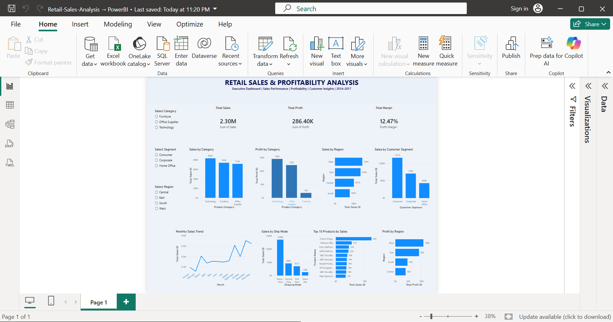

# Retail Sales & Profitability Analysis

## Project Overview

This project analyzes retail sales data to identify sales trends, profitability, product performance, regional performance, and customer purchasing patterns.

The objective is to generate meaningful business insights using Python, SQL, and Power BI.

## Tools & Technologies

- Python
- Pandas and NumPy
- Matplotlib and Seaborn
- MySQL
- Power BI
- Microsoft Excel

## Project Workflow

1. Data collection and exploration
2. Data cleaning and preprocessing using Python
3. Exploratory Data Analysis (EDA)
4. SQL analysis using MySQL
5. Business performance analysis
6. Interactive dashboard development using Power BI

## Key Performance Indicators

- Total Sales: 2.30M
- Total Profit: 286.40K
- Profit Margin: 12.47%

## Dashboard Features

- Sales by Category
- Profit by Category
- Sales by Region
- Profit by Region
- Monthly Sales Trend
- Sales by Customer Segment
- Sales by Ship Mode
- Top 10 Products by Sales
- Interactive Region, Category, and Segment filters

## Dashboard Preview



## Key Business Insights

- Technology generates the highest sales and profit among the product categories.
- The West region records the highest sales and profit.
- Consumer customers contribute the largest share of sales.
- Standard Class is the most frequently used shipping mode.
- Monthly sales trends help identify seasonal business patterns.

## Project Structure

```text
Retail-Sales-Analysis/
│
├── Dataset/
│   └── Processed/
│
├── Images/
├── Notebooks/
├── PowerBI/
├── Reports/
├── SQL/
│
└── README.md
```

## Conclusion

This project demonstrates practical data analytics skills, including data cleaning, exploratory analysis, SQL querying, business insights generation, and interactive dashboard development.
